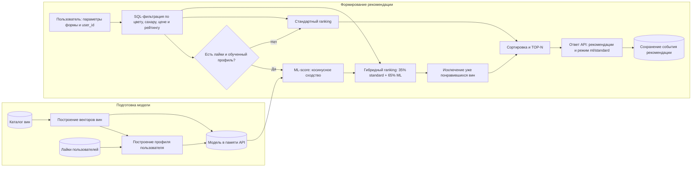

# Место ML-модели в процессе рекомендации вина

## Схема процесса



Схема описывает два связанных процесса. В offline-части сервис строит модель по
каталогу и накопленным лайкам. В online-части структурированные параметры формы
сразу применяются как фильтры, после чего оставшиеся товары ранжируются с использованием
модели либо fallback-алгоритма.

## Какую задачу решает модель

Модель решает задачу персонального ранжирования вин. Она не выбирает товары из
всего каталога напрямую: сначала бизнес-правила удаляют варианты, не подходящие
под явно заданные требования пользователя. Затем модель оценивает сходство
каждого оставшегося вина с историей его лайков и повышает наиболее похожие
позиции в выдаче.

## Почему здесь целесообразно использовать ML

Одинаковые параметры, например красное сухое вино до 1500 рублей, могут выбрать
пользователи с разными вкусами. Фиксированная формула рейтинга покажет им почти
одинаковую выдачу. Content-based подход позволяет автоматически агрегировать
несколько предпочтений пользователя и учитывать сочетание характеристик — цвет,
сахар, виноград, страну, бренд, цену и рейтинг.

Для MVP этот подход особенно удобен, потому что:

- не требует большой истории взаимодействий всех пользователей;
- способен оценивать вино по его атрибутам;
- результат легко объяснить сходством с понравившимися товарами;
- вычислительно прост и работает на небольшом каталоге без отдельного ML-сервера.

## Какие данные поступают на вход модели

На этапе подготовки модели используются:

- доступные вина из базы данных;
- цена и внешний рейтинг;
- цвет и тип сахара;
- страна, бренд и сорта винограда;
- связи между пользователями и понравившимися винами.

Во время запроса модель получает `user_id` и идентификаторы вин-кандидатов,
которые уже прошли жёсткую фильтрацию по структурированным параметрам формы.
Сами параметры непосредственно в ML-вектор не входят.

## Как результат используется дальше

Модель возвращает для каждого кандидата значение сходства `ml_score`. Далее
сервис объединяет его с базовой оценкой, рассчитанной по рейтингу, соответствию
цене и популярности:

```text
final_score = (1 - ML_PERSONALIZATION_WEIGHT) * standard_score
              + ML_PERSONALIZATION_WEIGHT * ml_score
```

При значении настройки по умолчанию доля ML составляет 65%. Уже понравившиеся
вина исключаются, остальные сортируются по убыванию итогового score, после чего
пользователю возвращается TOP-N. Факт рекомендации сохраняется в базе для
истории и будущего анализа.

Если у пользователя нет лайков или его профиль ещё не построен, ML-score не
используется. Процесс не завершается ошибкой: система применяет стандартное
ранжирование и помечает ответ как `recommendation_mode = "standard"`.

## Точки интеграции в проекте

| Этап | Компонент проекта |
|---|---|
| Загрузка каталога и лайков | `db/repositories/repository.py` |
| Построение векторов и профилей | `ml/recommender.py` |
| Запуск обучения | `ml/runtime.py`, `POST /ml/retrain` |
| Схема параметров фильтрации | `recommendation/filters.py` |
| SQL-фильтрация | `db/repositories/repository.py` |
| Проверка ограничений и объединение score | `recommendation/service.py` |
| Базовая формула ranking | `recommendation/ranking.py` |
| Оркестрация HTTP-запроса | `api/routes/recommendations.py` |
