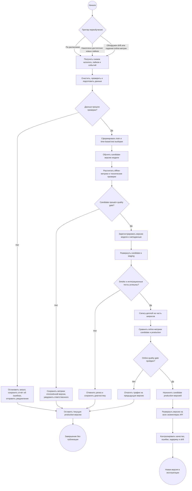

# Процесс автоматического переобучения ML-модели

## Назначение документа

Документ описывает целевой процесс автоматического переобучения content-based
модели Wine Recommendation Service: от появления новых данных до публикации и
развёртывания проверенной версии.

В текущей версии проекта модель строится при запуске API либо вручную через
`POST /ml/retrain` и хранится в памяти процесса. Представленный ниже процесс —
схема развития решения до полноценного автоматического MLOps-конвейера.

## Схема процесса



## Триггеры запуска

Переобучение запускает оркестратор, например CI/CD scheduler, Airflow или
аналогичный сервис. Предусматриваются три вида триггеров:

1. **Регулярный:** запуск по расписанию, например один раз в сутки ночью.
2. **По объёму данных:** после накопления заданного количества новых лайков или
   существенного обновления каталога.
3. **По мониторингу:** при обнаружении drift входных данных либо устойчивом
   ухудшении `CTR`, like conversion или других online-метрик.

Для учебного MVP основным предлагается ежедневный запуск. Дополнительное
условие защищает от бессмысленного переобучения: с момента последней успешной
версии должны появиться новые вина или лайки.

## Этапы и передаваемые результаты

| № | Этап | Что происходит | Результат для следующего шага |
|---:|---|---|---|
| 1 | Фиксация триггера | Оркестратор создаёт запуск с уникальным `run_id`, временем и причиной запуска | Карточка запуска и ссылка на текущую production-версию |
| 2 | Получение данных | Из PostgreSQL читаются доступные вина, их признаки, пользовательские лайки и события рекомендаций | Неизменяемый снимок данных с временной меткой |
| 3 | Подготовка данных | Удаляются дубликаты, проверяются связи `user_id`–`wine_id`, типы, диапазоны цены и рейтинга, обязательные поля и свежесть каталога | Валидированный набор данных и отчёт о качестве данных |
| 4 | Разделение данных | Для offline-оценки последние взаимодействия пользователя откладываются в test, более ранние используются для train | Train/test-наборы без утечки будущих взаимодействий |
| 5 | Обучение | По train-данным строятся векторы вин и усреднённые профили пользователей | Candidate-модель, параметры признаков и статистика обучения |
| 6 | Offline-проверка | Рассчитываются рекомендательные метрики, проверяются покрытие, корректность score, время построения и инференса | Отчёт с метриками candidate и сравнением с production |
| 7 | Решение о публикации | Quality gate автоматически проверяет обязательные пороги и отсутствие регрессии | Решение `accepted` или `rejected` с причинами |
| 8 | Регистрация | Для принятой модели сохраняются версия, артефакт, конфигурация, хэш данных, метрики, commit SHA и время обучения | Воспроизводимая версия в Model Registry/хранилище |
| 9 | Staging | Candidate загружается в тестовый экземпляр API | Работающий staging endpoint с новой версией |
| 10 | Smoke-тесты | Проверяются загрузка модели, ответы API, fallback для cold start, исключение лайков и допустимые задержки | Разрешение либо запрет canary-деплоя |
| 11 | Canary | Небольшая доля запросов направляется на candidate; остальной трафик обслуживает production | Online-метрики двух версий на сопоставимых группах |
| 12 | Продвижение или откат | При успешной проверке candidate становится production; при регрессии трафик возвращается на прежнюю версию | Новая production-версия либо сохранённая предыдущая версия |
| 13 | Мониторинг | После полного деплоя отслеживаются качество, ошибки, задержка, доля fallback и drift | Сигналы нормальной работы или новый триггер/откат |

## Подготовка и проверка новых данных

Перед обучением pipeline должен проверить:

- снимок данных не пуст и содержит доступные вина;
- идентификаторы вин и пользователей уникальны и корректны;
- каждый лайк ссылается на существующие объекты;
- цена положительна, рейтинг находится в диапазоне от 0 до 5, количество
  отзывов неотрицательно;
- доля пропусков по цвету, сахару, стране, бренду и винограду не превышает
  установленный порог;
- объём данных и распределения признаков не изменились аномально относительно
  предыдущего успешного запуска;
- временная граница train/test исключает попадание будущих событий в обучение.

Если обязательная проверка не пройдена, обучение не запускается. Отчёт
сохраняется, ответственному отправляется уведомление, а production-модель
продолжает работать без изменений.

## Проверка качества candidate-модели

### Offline-метрики

Для content-based ранжирования предлагаются:

- `NDCG@5` — основная метрика качества порядка рекомендаций;
- `Precision@5` и `Recall@5` — точность и полнота TOP-5;
- `HitRate@5` — доля пользователей, для которых найден релевантный товар;
- catalog coverage — доля каталога, появившаяся в рекомендациях;
- доля пользователей, для которых доступен режим `ml`, а не fallback;
- p95 времени расчёта рекомендаций и объём артефакта модели.

### Пример автоматического quality gate

Конкретные пороги должны быть утверждены после накопления репрезентативной
истории. Для первой версии процесса можно использовать следующие стартовые
условия:

```text
NDCG@5(candidate) >= NDCG@5(production) - 0.01
Precision@5(candidate) >= Precision@5(production) - 0.01
catalog_coverage(candidate) >= 0.90 * catalog_coverage(production)
ml_profile_coverage(candidate) >= 0.95 * ml_profile_coverage(production)
p95_latency(candidate) <= 1.20 * p95_latency(production)
все функциональные и интеграционные тесты пройдены
```

Это относительные ограничения: candidate не должен заметно ухудшать текущую
версию. После появления стабильного baseline к ним следует добавить абсолютные
минимальные значения. Решение и фактические показатели сохраняются независимо
от результата проверки.

## Регистрация новой версии

После успешного offline quality gate создаётся неизменяемая версия, например
`wine-recommender-YYYYMMDD-HHMM-<commit>`.

Для воспроизводимости вместе с моделью сохраняются:

- сериализованные векторы вин и профили пользователей;
- версия алгоритма и commit SHA;
- значения весов признаков и `ML_PERSONALIZATION_WEIGHT`;
- хэш и временной диапазон обучающего снимка;
- количество вин, пользователей и лайков;
- offline-метрики и решение quality gate;
- версия Python и зависимостей;
- статус жизненного цикла: `candidate`, `staging`, `production`, `rejected` или
  `archived`.

Артефакт должен храниться во внешнем versioned-хранилище или Model Registry, а
не только в памяти API.

## Деплой и безопасное продвижение

1. Candidate загружается в staging и проходит smoke- и интеграционные тесты.
2. После успешных тестов новая версия обслуживает небольшую долю трафика.
3. На canary-этапе сравниваются CTR/like conversion, ошибки, задержка, доля
   пустых выдач и fallback с текущей production-версией.
4. Если статистически и практически значимой регрессии нет, версия постепенно
   получает 100% трафика и помечается как `production`.
5. Все экземпляры API загружают один и тот же версионированный артефакт; endpoint
   состояния должен возвращать идентификатор активной версии.

## Действия при неуспешных проверках

- **Ошибка данных:** остановить pipeline до обучения, сохранить отчёт и
  уведомить ответственного за источник данных.
- **Низкое offline-качество:** зарегистрировать запуск как `rejected`, не
  отправлять модель в staging и продолжить использовать production-версию.
- **Ошибка smoke-тестов:** снять candidate со staging, сохранить логи и открыть
  задачу на исправление.
- **Регрессия на canary:** немедленно вернуть весь трафик на предыдущую версию,
  пометить candidate как `rejected` и сохранить результаты эксперимента.
- **Проблемы после полного деплоя:** выполнить автоматический rollback на
  последнюю стабильную версию и приостановить дальнейшее продвижение до разбора
  причины.

Во всех неуспешных сценариях действующая production-модель остаётся доступной:
ошибка переобучения не должна останавливать сервис рекомендаций.

## Связь с текущей реализацией

| Часть процесса | Существующая реализация | Необходимо добавить |
|---|---|---|
| Получение каталога и лайков | `Repository.candidates()` и `Repository.likes_by_user()` | снимок данных и его версионирование |
| Обучение | `ContentBasedRecommender.fit()` | запуск оркестратором и сохранение артефакта |
| Ручной запуск | `POST /ml/retrain` | расписание и data/drift-триггеры |
| Функциональные проверки | unit- и integration-тесты | offline-датасет и расчёт рекомендательных метрик |
| Хранение | память одного процесса API | Model Registry или versioned object storage |
| Деплой | обучение при старте API | staging, canary, promotion и rollback |
| Мониторинг | логирование запросов и событий | дашборд качества, latency, fallback и drift |

Таким образом, автоматический pipeline не заменяет существующий алгоритм
рекомендаций, а делает его обновление контролируемым, воспроизводимым и
безопасным для production-сервиса.
