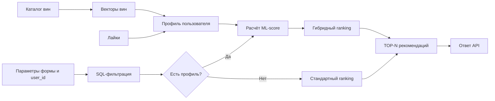

# ML-модель Wine Recommendation Service

## Назначение модели

В проекте используется самописная content-based рекомендательная модель. Она персонализирует порядок вин после применения обязательных фильтров пользователя.

Модель не выбирает товары из всего каталога. Сначала сервис исключает вина, которые не соответствуют цвету, типу сахара, цене и минимальному рейтингу. Затем ML-модель поднимает выше товары, похожие на ранее понравившиеся пользователю.

Версия модели: `0.1.0`, статус: учебный MVP. Реализация находится в `src/wine_recommendation/ml/recommender.py`.

## Почему используется ML

Пользователи с одинаковыми параметрами фильтрации могут иметь разные вкусы. Обычная сортировка по рейтингу вернёт им почти одинаковую выдачу, а content-based модель учитывает индивидуальную историю лайков.

Этот подход подходит для MVP, потому что:

- работает на небольшом каталоге;
- не требует большой общей истории пользователей;
- использует понятные характеристики вин;
- результат можно объяснить сходством с понравившимися товарами;
- для инференса не требуется отдельный ML-сервис.

## Входные данные

При построении модели используются:

- доступные вина из PostgreSQL;
- цена и внешний рейтинг;
- цвет и тип сахара;
- страна и бренд;
- сорта винограда;
- лайки пользователей в формате `user_id -> wine_id`.

При формировании рекомендации модель получает `user_id` и список идентификаторов вин, которые уже прошли обязательную SQL-фильтрацию.

## Как работает модель

Каждое вино преобразуется в нормализованный вектор признаков.

| Признак | Преобразование или вес |
|---|---:|
| Цена | `price / max_price_in_catalog` |
| Рейтинг | `rating / 5` |
| Цвет | 2.0 |
| Тип сахара | 2.0 |
| Сорт винограда | 1.5 |
| Страна | 1.0 |
| Бренд | 0.75 |

Профиль пользователя строится как среднее значение векторов понравившихся вин:

```text
user_profile = normalize(mean(vectors_of_liked_wines))
```

ML-score равен косинусному сходству профиля пользователя и вектора вина:

```text
ml_score = dot(user_profile, wine_vector)
```

Значение ближе к единице означает большее сходство с предпочтениями пользователя.

## Итоговое ранжирование

ML-score объединяется со стандартной оценкой товара:

```text
final_score = 0.35 * standard_score + 0.65 * ml_score

standard_score = 0.55 * rating
               + 0.25 * price_fit
               + 0.20 * popularity
               + preference_bonus
```

После расчёта сервис исключает уже понравившиеся вина, сортирует кандидатов по итоговому score и возвращает TOP-N.

Если у пользователя нет лайков или профиль ещё не построен, система использует стандартное ранжирование. В ответе API режим обозначается как `recommendation_mode = "standard"` вместо `ml`.

## Место модели в процессе



Основные этапы процесса:

1. Сервис получает параметры формы и `user_id`.
2. PostgreSQL отбирает вина, соответствующие обязательным ограничениям.
3. При наличии профиля модель вычисляет сходство каждого кандидата с предпочтениями пользователя.
4. Сервис объединяет ML-score со стандартным ranking.
5. API возвращает TOP-N и сохраняет событие рекомендации.

## Обучение и эксплуатация

Модель строится:

- при запуске приложения, если включена настройка `ML_TRAIN_ON_STARTUP`;
- вручную через endpoint `POST /ml/retrain`.

Векторы вин и профили пользователей хранятся в оперативной памяти API. После появления новых лайков требуется повторное обучение.

Команда ручного переобучения:

```bash
curl -X POST http://localhost:8000/ml/retrain
```

Пример запроса рекомендаций:

```bash
curl -X POST http://localhost:8000/recommendations \
  -H 'Content-Type: application/json' \
  -d '{"user_id":1,"color":"red","sugar_type":"dry","max_price":1500,"min_rating":4,"limit":5}'
```

## Метрики качества

Текущие unit- и integration-тесты проверяют корректность алгоритма, фильтрацию, сортировку, исключение ранее понравившихся вин и fallback без профиля.

Отдельный evaluation-датасет пока не подготовлен, поэтому значения качества рекомендательной системы не измерены. Для дальнейшей оценки предлагаются:

- `NDCG@5` как основная offline-метрика порядка рекомендаций;
- `Precision@5`, `Recall@5` и `HitRate@5`;
- покрытие каталога;
- CTR и конверсия рекомендации в лайк;
- A/B-тест против стандартного ranking.

## Основные ограничения

- Без лайков персонализация невозможна.
- Новое вино попадёт в модель только после переобучения.
- Учитывается только положительная обратная связь.
- Ручные веса ещё не оптимизированы на реальной истории.
- Content-based подход может создавать однообразную выдачу.
- Модель хранится в памяти и не синхронизируется между несколькими экземплярами API.
- Функциональные тесты подтверждают корректность кода, но не доказывают бизнес-эффект.

## Итог

Модель добавляет персонализацию поверх обязательных бизнес-фильтров и стандартного ranking. Решение остаётся объяснимым: итоговый порядок зависит от характеристик вина, истории лайков, рейтинга, соответствия цене и популярности. При отсутствии данных система продолжает работать в fallback-режиме.
