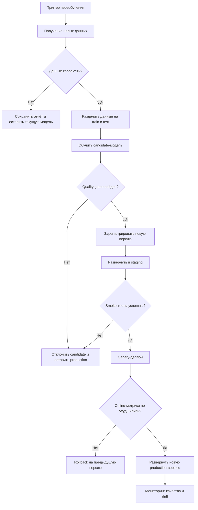

# Автоматическое переобучение ML-модели

## Назначение процесса

Процесс описывает полный цикл обновления content-based модели Wine Recommendation Service: от появления новых данных до безопасного развёртывания новой версии.

В текущем MVP модель строится при запуске API или вручную через `POST /ml/retrain` и хранится в памяти процесса. Автоматический pipeline, Model Registry, staging, canary и rollback описывают целевое развитие проекта.

## Общая схема



## 1. Триггер запуска

Переобучение может запускаться:

- по расписанию, например один раз в сутки;
- после накопления заданного количества новых лайков;
- после значительного обновления каталога;
- при обнаружении drift данных или ухудшении online-метрик.

Оркестратор создаёт запуск с уникальным `run_id`, временем и причиной запуска.

## 2. Получение и подготовка данных

Из PostgreSQL загружаются:

- доступные вина и их признаки;
- пользователи и лайки;
- события показов рекомендаций.

Pipeline создаёт неизменяемый снимок данных и проверяет:

- наличие доступных вин;
- уникальность идентификаторов;
- корректность связей между лайками, пользователями и винами;
- допустимые значения цены, рейтинга и количества отзывов;
- долю пропусков;
- свежесть каталога;
- аномальные изменения объёма и распределений данных.

Если обязательная проверка не пройдена, обучение не запускается. Система сохраняет отчёт, отправляет уведомление и продолжает использовать текущую production-модель.

## 3. Разделение данных

Данные делятся по времени:

- ранние взаимодействия используются для обучения;
- последние действия пользователя формируют test-набор.

Такое разделение исключает попадание будущих действий пользователя в обучающие данные.

## 4. Обучение candidate-модели

На train-данных строятся:

- векторы признаков вин;
- усреднённые профили пользователей;
- параметры нормализации и статистика обучения.

Результатом становится candidate-модель, которая пока не обслуживает production-трафик.

## 5. Проверка качества

Для candidate рассчитываются:

- `NDCG@5`;
- `Precision@5` и `Recall@5`;
- `HitRate@5`;
- покрытие каталога;
- доля пользователей с доступным ML-профилем;
- время обучения и p95 задержки рекомендаций;
- результаты функциональных и интеграционных тестов.

Quality gate сравнивает candidate с текущей production-версией. Новая модель допускается к дальнейшему развёртыванию, только если она не создаёт недопустимую регрессию качества или производительности.

Пример относительных условий:

```text
NDCG@5(candidate) >= NDCG@5(production) - 0.01
Precision@5(candidate) >= Precision@5(production) - 0.01
catalog_coverage(candidate) >= 0.90 * catalog_coverage(production)
p95_latency(candidate) <= 1.20 * p95_latency(production)
все функциональные и интеграционные тесты пройдены
```

Конкретные пороги следует утвердить после накопления репрезентативной истории.

## 6. Регистрация версии

Для принятой модели создаётся неизменяемая версия, например:

```text
wine-recommender-YYYYMMDD-HHMM-<commit>
```

Вместе с моделью сохраняются:

- векторы вин и профили пользователей;
- версия алгоритма и commit SHA;
- настройки весов;
- хэш и временной диапазон данных;
- количество вин, пользователей и лайков;
- рассчитанные метрики;
- версия Python и зависимостей;
- статус модели: `candidate`, `staging`, `production`, `rejected` или `archived`.

Артефакт должен храниться во внешнем версионируемом хранилище или Model Registry, а не только в памяти API.

## 7. Staging и smoke-тесты

Candidate загружается в тестовый экземпляр API. Smoke- и интеграционные тесты проверяют:

- успешную загрузку модели;
- корректные ответы API;
- fallback для пользователя без профиля;
- исключение уже понравившихся вин;
- допустимую задержку ответа.

Ошибка на этом этапе отменяет релиз. Production продолжает использовать предыдущую модель.

## 8. Canary-деплой

После успешных smoke-тестов небольшая часть запросов направляется на candidate. Остальной трафик продолжает обслуживать текущая production-версия.

Сравниваются:

- CTR и конверсия рекомендации в лайк;
- количество ошибок;
- задержка ответа;
- доля пустых выдач;
- доля fallback-режима.

Если значимой регрессии нет, candidate получает весь трафик и становится новой production-версией.

## 9. Мониторинг после деплоя

После полного развёртывания система продолжает контролировать:

- качество рекомендаций;
- ошибки API;
- p95 задержки;
- долю режима `standard` вместо `ml`;
- свежесть модели;
- drift входных данных.

Проблема после релиза запускает автоматический rollback на последнюю стабильную версию.

## Действия при ошибках

| Ошибка | Действие |
|---|---|
| Данные не прошли проверку | Остановить pipeline, сохранить отчёт и оставить production без изменений |
| Candidate ухудшает offline-метрики | Пометить версию как `rejected` и не отправлять её в staging |
| Ошибка smoke-тестов | Отменить релиз и сохранить диагностику |
| Регрессия во время canary | Вернуть весь трафик на предыдущую версию |
| Проблема после полного деплоя | Выполнить rollback и приостановить дальнейшее продвижение |

Во всех неуспешных сценариях сервис рекомендаций остаётся доступным и продолжает использовать последнюю стабильную модель.

## Текущая и целевая реализация

| Компонент | Сейчас | Требуется добавить |
|---|---|---|
| Получение данных | Каталог и лайки читаются из PostgreSQL | Версионируемый снимок данных |
| Обучение | `ContentBasedRecommender.fit()` | Запуск через оркестратор |
| Триггер | Старт API или `POST /ml/retrain` | Расписание, data- и drift-триггеры |
| Проверки | Unit- и integration-тесты | Offline-метрики и quality gate |
| Хранение модели | Память одного процесса API | Model Registry или object storage |
| Деплой | Обучение при старте приложения | Staging, canary, promotion и rollback |
| Мониторинг | Логирование запросов и событий | Метрики качества, latency, fallback и drift |

## Итог

Целевой pipeline делает обновление модели контролируемым и воспроизводимым. Новая версия попадает в production только после проверки данных, offline-метрик, тестов в staging и canary-сравнения. При любой ошибке система сохраняет предыдущую стабильную модель.
